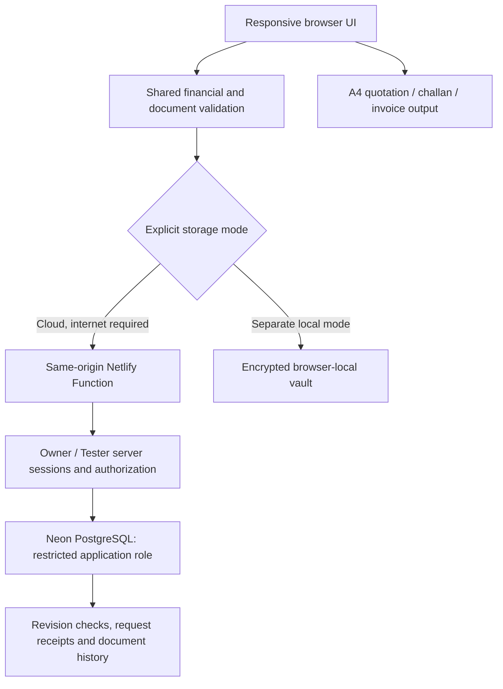

# Architecture overview

**PressFlow V2 · Designed & developed by MBS**

## Business invariants

- A pending dispatch reserves quantities but is not an invoiced completed delivery.
- Invoices allocate exact quantities from completed source challans.
- Issued document snapshots are not silently rewritten by later payments or edits.
- Delivery, invoicing and payment progress are independent.
- Corrections retain history rather than silently replacing receipts.

## Failure handling

Cloud saves are acknowledged by the backend. Revision checks prevent a stale device
from overwriting a newer book. Request receipts help reconcile a response lost after
a commit; they do not justify blindly reissuing the same business operation.
Authentication and business writes are checked on the server. The browser does not
receive database credentials.

Local mode is a separate encrypted browser vault, not an offline cloud queue.
Cloud mode requires connectivity and does not silently switch storage modes.
The save/load status is not an automatic real-time synchronization subscription.

## Showcase boundary

Screenshots and video use local in-memory demo records, not a real cloud session.
Cloud architecture is described here, not simulated as a successful live cloud save.
This repository contains presentation assets only, with no deployable backend,
credentials or infrastructure configuration. Production acceptance remains separate.
