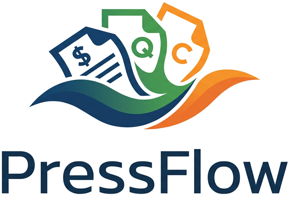
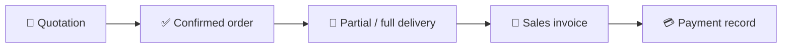
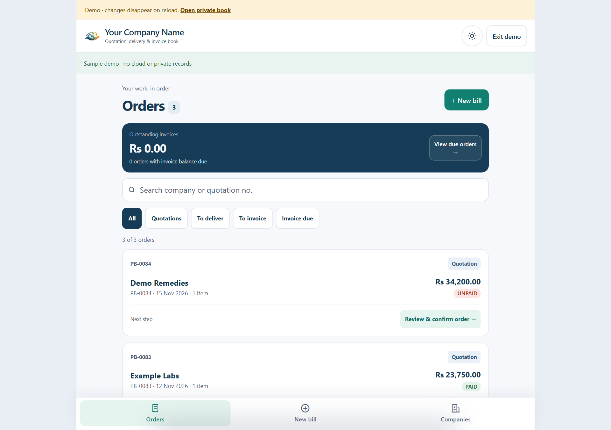
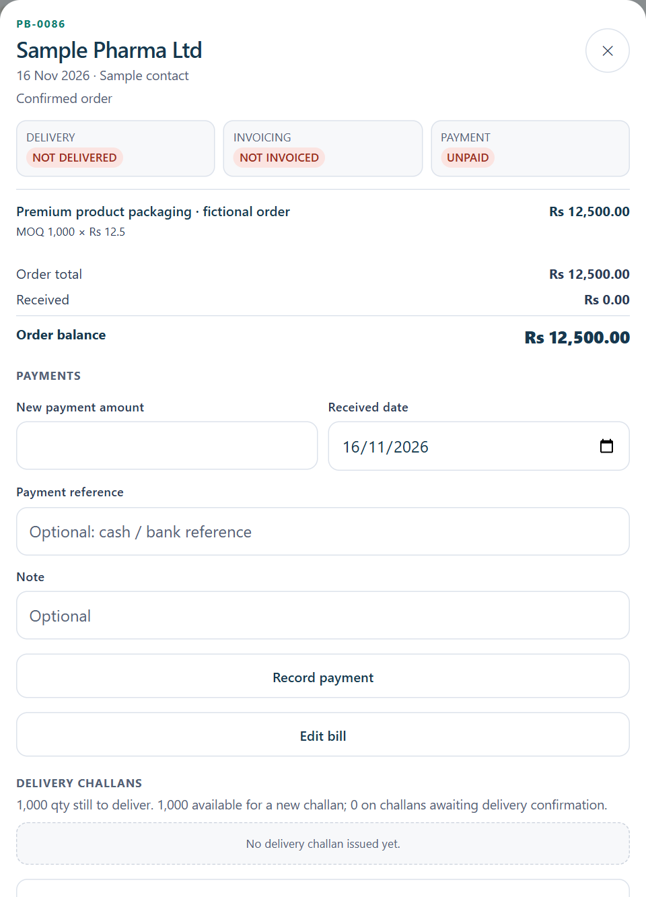
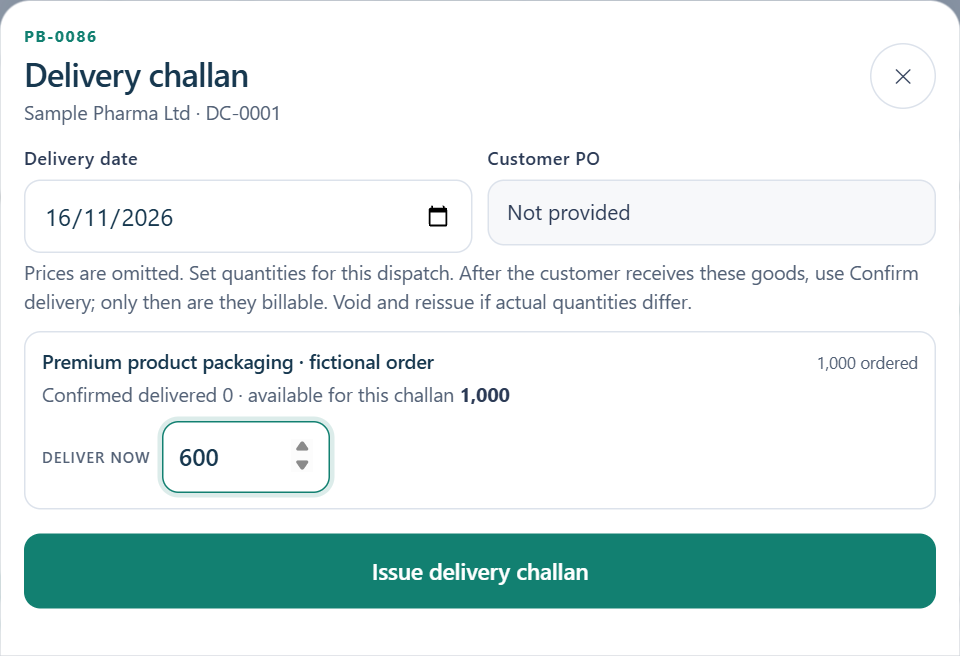
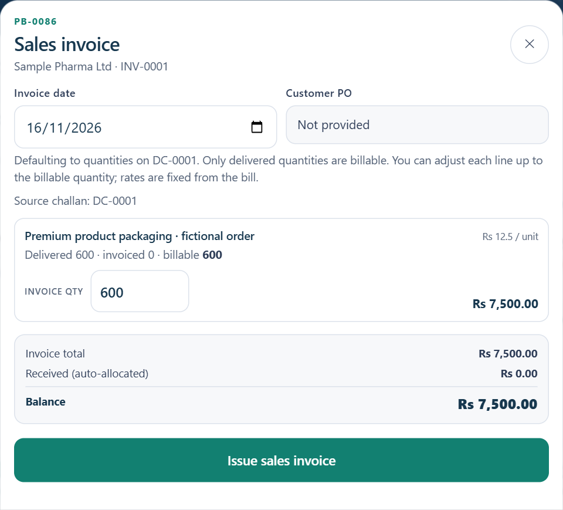
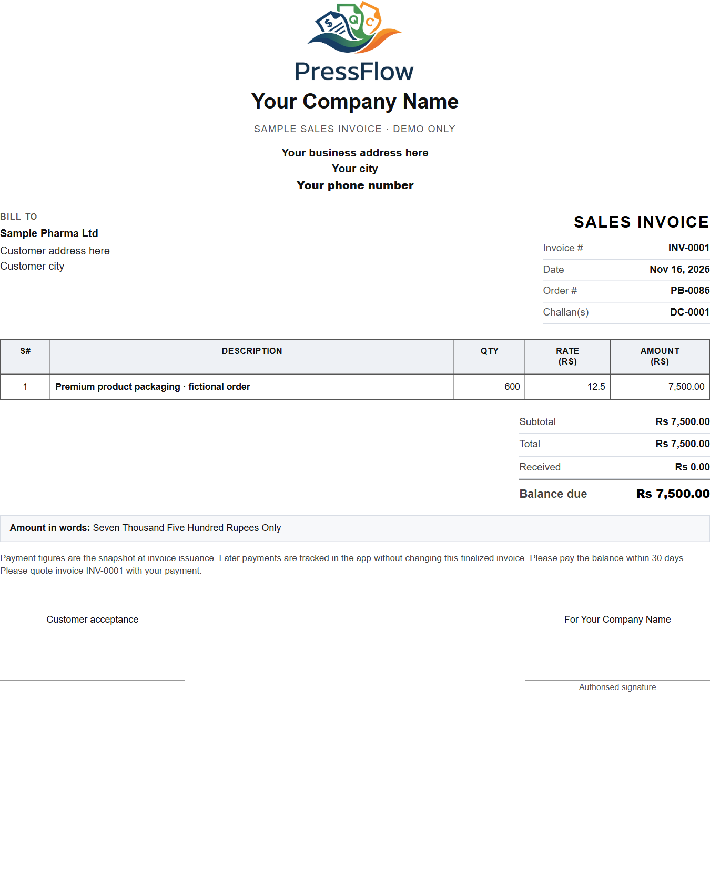

# 🖨️ PressFlow — Print Business Management

### From quotation to payment. One connected workflow.

**Designed & developed by MBS**

[🎬 Watch the Showcase](media/pressflow-v2-showcase.mp4) · [📄 Sample Invoice](media/sample-invoice.pdf) · [🏗️ Architecture](ARCHITECTURE.md)

---

## 💡 Overview

PressFlow is a purpose-built workspace for the everyday operations of a printing
business. It connects quotations, confirmed orders, partial deliveries, delivery-linked
invoices and payment records—without losing the history behind each document.

The focus is practical: **clear next actions, accurate quantities, traceable payments
and professional A4 output**, on desktop and mobile.

## 🎬 Product Showcase

**[▶ Watch / download the 46-second video](https://raw.githubusercontent.com/M-Bilal-Sidd/PressFlow-Showcase/main/media/pressflow-v2-showcase.mp4)**

1080p · original instrumental soundtrack · actual demo interface · fictional records

## ✨ Key Features

| Feature | What it brings to the workflow |
| --- | --- |
| 📋 Order desk | Search, status filters, outstanding invoices and clear next actions |
| 📝 Quotations & orders | Capture quantities and rates, then confirm accepted work |
| 🚚 Partial deliveries | Dispatch in stages with separately numbered delivery challans |
| 🧾 Delivery-linked invoicing | Allocate exact completed-delivery quantities without reusing them |
| 💳 Payment history | Dated receipts, references and explicit, traceable corrections |
| 📄 A4 documents | Quotations, challans and invoices with preserved issuance snapshots |
| 📱 Responsive interface | Touch-friendly navigation and light/dark themes |
| 🔐 Protected cloud book | Independent Owner/Tester sign-in with server-checked sessions |
| 🛡️ Safer updates | Revision checks and request receipts for stale or uncertain saves |

## 🔄 Business Workflow

Delivery, invoicing and payment progress remain **independent**. A later receipt does
not silently rewrite the financial snapshot of an already-issued invoice.

## 🛠️ Tech Stack

| Layer | Technologies |
| --- | --- |
| Frontend | JavaScript, HTML5, CSS3, responsive layouts |
| Backend | Node.js, same-origin Netlify Functions |
| Cloud database | Neon PostgreSQL, restricted application role |
| Authentication | Password hashing, server sessions, server-side authorization |
| Data integrity | Shared validators, decimal helpers, revision checks, request receipts |
| Separate local mode | Encrypted browser-local vault |
| Documents | Browser-based A4 print / PDF layouts |

Explore the [architecture and engineering decisions](ARCHITECTURE.md).

## 📸 Interface Gallery

### Order Desk

| 📝 Quotation | ✅ Confirmed Order |
| --- | --- |
|  |  |

| 🚚 Partial Delivery | 🧾 Sales Invoice |
| --- | --- |
|  |  |

| 💳 Payment History | 📄 A4 Invoice |
| --- | --- |
|  |  |

### 📱 Mobile · Dark Theme

## 🧠 Engineering Focus

- **Quantity integrity:** pending dispatches reserve quantities; only completed
  deliveries can be invoiced.
- **Financial history:** fixed-decimal helpers and immutable issued-document snapshots.
- **Reliable writes:** revision conflicts prevent stale overwrites; request receipts
  help reconcile acknowledgements lost after a commit.
- **Explicit storage modes:** the encrypted local vault is separate from cloud mode,
  not an offline cloud queue.

## 📌 Project Scope

This repository is a **public product case study and media showcase**. The private
application source and deployment configuration are not distributed here.
All displayed business records are fictional. The showcase is not a production-release
certification; device, print and recovery acceptance remain separate.

Cloud mode requires internet. Its status label reports the last confirmed save/load;
automatic live refresh is not claimed.

---

**Built around the workflow. Designed & developed by MBS.**

[GitHub Profile](https://github.com/M-Bilal-Sidd) · [Explore the Architecture](ARCHITECTURE.md)

