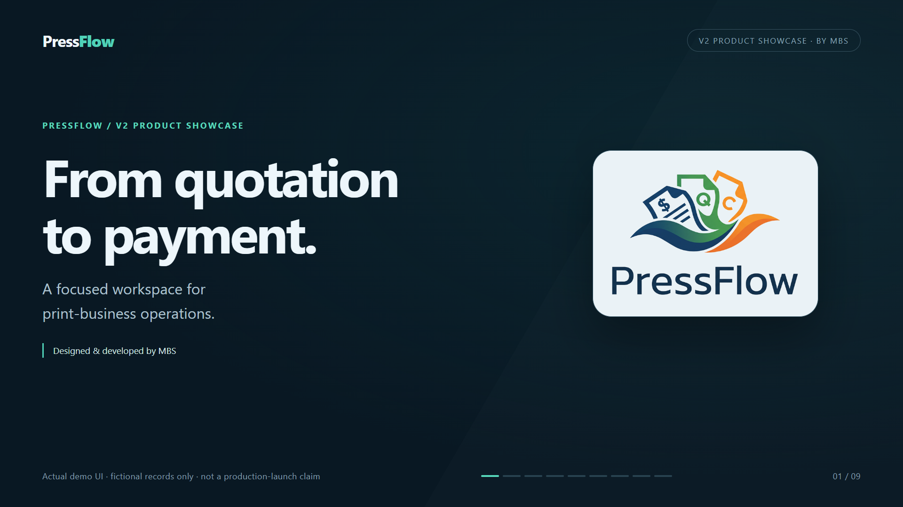
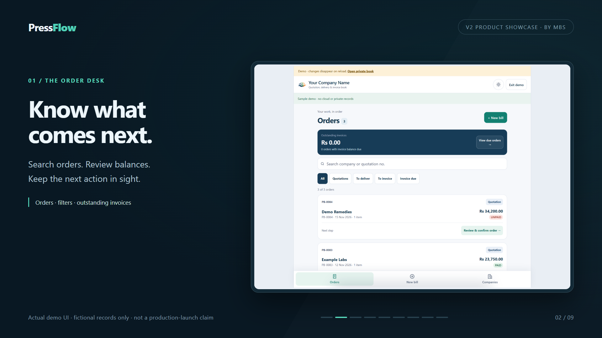
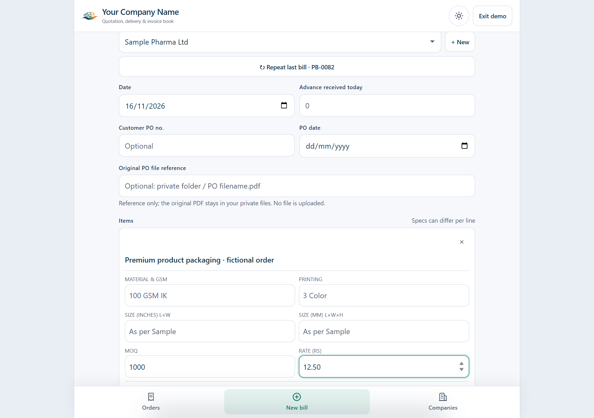
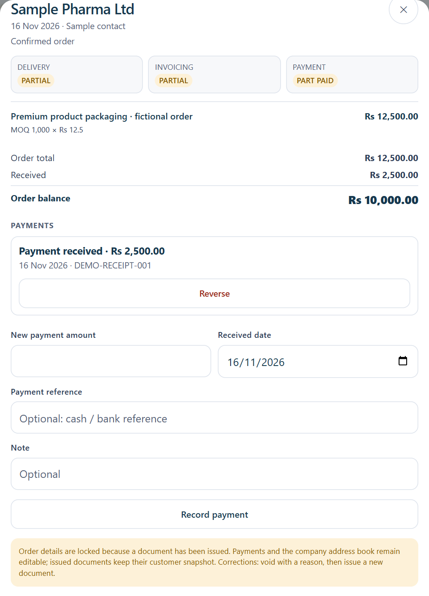
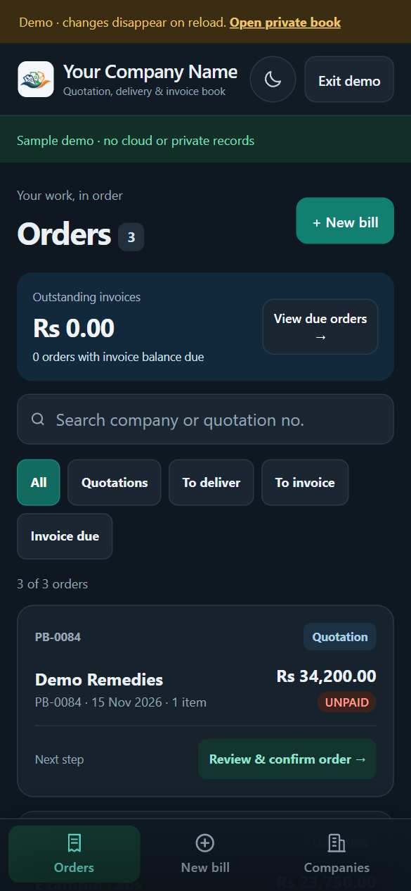

# PressFlow — V2 Product Showcase

### From quotation to payment.
**Designed & developed by MBS**

**[Watch / download the 46-second showcase](media/pressflow-v2-showcase.mp4)** ·
[Download raw MP4](https://raw.githubusercontent.com/M-Bilal-Sidd/PressFlow-Showcase/main/media/pressflow-v2-showcase.mp4) ·
[Sample A4 invoice](media/sample-invoice.pdf)

PressFlow brings print-business quotations, confirmed orders, partial deliveries,
sales invoices and dated payments into a focused, mobile-friendly workspace.

## The workflow

1. **Quote:** capture customer, product, quantity and rate details.
2. **Confirm:** move an accepted quotation into an order.
3. **Deliver:** issue partial or full delivery challans and confirm receipt.
4. **Invoice:** bill exact delivered quantities against their source challans.
5. **Record payment:** retain dated receipts and traceable corrections.

## Engineering highlights

- Responsive desktop/mobile UI, light/dark themes and A4 print layouts.
- Separate delivery, invoicing and payment status.
- Fixed-decimal helpers for financial calculations and immutable document snapshots.
- Cloud path: same-origin Netlify Functions with Neon PostgreSQL.
- Independent Owner/Tester passwords, server sessions and protected business endpoints.
- Revision-based writes and request receipts to detect stale updates and reconcile
  uncertain acknowledgements.
- Encrypted browser-local mode exists separately; cloud mode has no silent local fallback.

Read the [architecture](ARCHITECTURE.md) and [media notes](MEDIA-NOTES.md).

## Screenshots

| Quotation | Partial delivery |
| --- | --- |
|  |  |

| Sales invoice | Payment history |
| --- | --- |
|  |  |

## Scope and privacy

This is a **sanitized portfolio repository**, not the production application source.
All captured records are fictional, generated in an isolated local demo.
No private customer data, credentials, database URLs, application configuration,
backups or private Git history are included.

V2 remains a product showcase, **not production certification**. Device, printer and
backup/restore acceptance are separate release gates. Cloud mode requires internet.
The sync label reports the last confirmed save/load; automatic live refresh is not claimed.
No public business-book login or hosted business endpoint is linked here.
